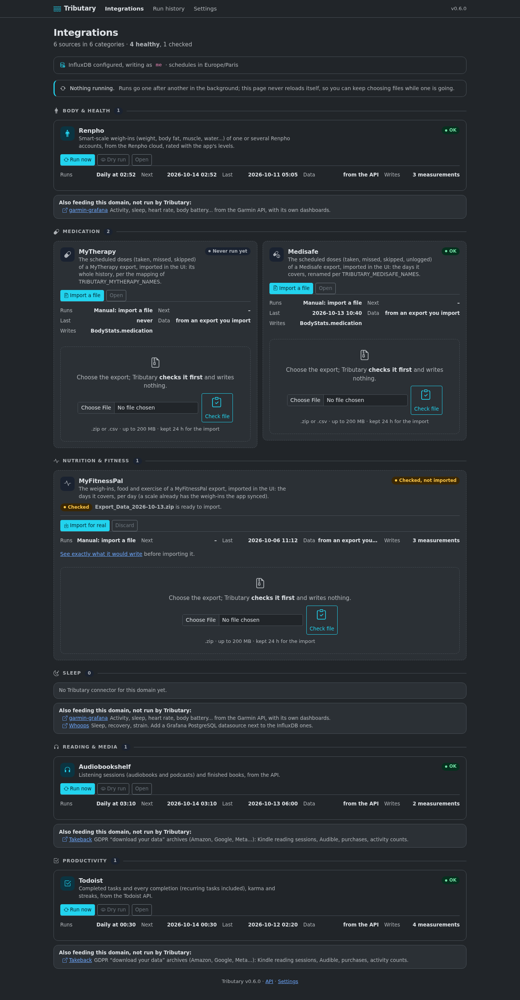

# Tributary

Self-hosted, docker-first: Tributary pulls your personal measurements from
the apps and devices that hold them into **InfluxDB 1.x**, and ships
**Grafana dashboards** to look at them. Think
[garmin-grafana](https://github.com/arpanghosh8453/garmin-grafana), for
many sources.

- **Integrations**, one per source, grouped by domain: from its API on a
  schedule, from its export files (upload, or a watched folder), or both.
- **A web UI**: every source with its schedule and last runs, *Run now*, *Dry
  run* (the exact line protocol, nothing written), *Full resync*, a file you
  **check before importing**, and the history of every run.
- **Schedules set in the UI**: per source, as a preset or a cron expression —
  no environment variable to change and no redeploy.
- **One shared schema** ([docs/schema.md](docs/schema.md)): a database per
  domain (`MediaStats`, `BodyStats`, `SleepStats`...), a `source` tag per
  tracker, fixed field types. Other tools write into the same databases
  ([compatible tools](docs/compatible-tools.md)), so one Grafana relates
  everything: reading in the evening and sleep, weight and activity...
- **Append-only and idempotent:** a point rewritten overwrites itself;
  nothing a source later forgets is dropped.
- **Private by default:** numbers and a few tags leave, titles as the only
  text (task names too, if you ask); secrets stay in the environment.


<sub>Light and dark follow your system (**dark** below). Every source is shown unless
you hide it in [Settings](#settings); hiding never stops a run.</sub>



## Integrations

Grouped by what a person is actually looking at. A source with an API runs on a
schedule; one that only has an export is imported from the UI when you have one.
The **compatible tools** are maintained projects that write into the same
databases — Tributary does not run them, and they are listed so a domain is
complete rather than to be configured here.

### Body & health

| Source | Input | Writes |
|---|---|---|
| **Renpho** | the API, daily, one account per person | `BodyStats`: `body_composition`, `body_levels`, `body_thresholds` |

Compatible tools: [**garmin-grafana**](https://github.com/arpanghosh8453/garmin-grafana) — the Garmin API, into `GarminStats` (activity, heart rate, body battery...).

### Medication

| Source | Input | Writes |
|---|---|---|
| **MyTherapy** | an export you import | `BodyStats`: `medication` |
| **Medisafe** | an export you import | `BodyStats`: `medication` |

### Nutrition & fitness

| Source | Input | Writes |
|---|---|---|
| **MyFitnessPal** | an export you import | `BodyStats`: `body_composition`, `nutrition`, `exercise` |

### Sleep

Nothing of Tributary's yet: sleep is covered by the tools below, and by Garmin
and Whoop reading it in place.

Compatible tools: [**garmin-grafana**](https://github.com/arpanghosh8453/garmin-grafana) (Garmin stats, into `GarminStats`), [**Whoops**](https://github.com/kryoseu/whoops) (Whoop, into PostgreSQL).

### Reading & media

| Source | Input | Writes |
|---|---|---|
| **Audiobookshelf** | the API, daily | `MediaStats`: `reading_session`, `book_finished` |

Compatible tools: [**Takeback**](https://github.com/vchatela-org/takeback) — GDPR archives (Kindle reading sessions, Audible), into `MediaStats`.

### Productivity

| Source | Input | Writes |
|---|---|---|
| **Todoist** | the API, daily | `TodoistStats`: `todoist_task_completed`, `todoist_completion`, `todoist_karma`, `todoist_stats` |

Compatible tools: [**Takeback**](https://github.com/vchatela-org/takeback) — GDPR archives (purchases, activity counts), into `ShoppingStats`, `DigitalStats`.

Each integration has its own page: [docs/connectors/](docs/connectors/), with what
it writes, which variables it reads and what it deliberately leaves out. A
connector is written only for a source no maintained tool covers: Garmin, for
instance, is [garmin-grafana](docs/compatible-tools.md)'s.
[Writing a connector](docs/connectors/README.md);
[porting a job that already feeds InfluxDB](docs/porting.md).

## Quick start

With Docker and Docker Compose:

```sh
git clone https://github.com/vchatela-org/tributary.git
cd tributary
cp .env.example .env    # then set the sources you use, e.g. TRIBUTARY_ABS_URL and TRIBUTARY_ABS_TOKEN
docker compose up -d
```

This builds Tributary and starts it with InfluxDB 1.11 and Grafana:

- Tributary: <http://127.0.0.1:8000>. Each configured source runs on its own
  schedule (a daily time by default); *Run now* and *Dry run* show what it does
  before that. A source with only an export is imported from its page: the file
  is **checked first** — nothing is written — and then imported.
- Grafana: <http://127.0.0.1:3000> (first login `admin` / `admin`), with
  the InfluxDB datasources and the proposed dashboards of
  [grafana/](grafana/) in a *Tributary* folder.

Already running InfluxDB or Grafana? See [docs/deployment.md](docs/deployment.md).

## Scheduling

Each source runs on a **5-field cron expression**, in `TRIBUTARY_TZ`. Set it on
the source's page — a preset (*Every hour*, *Daily at a time*, *Weekly on a day
and time*) or an expression you type — and the page shows the next five runs.
Times are absolute, so a restart no longer shifts a schedule.

Where a value comes from, in order: what you saved in the UI; else
`TRIBUTARY_<KEY>_SCHEDULE`; else the deprecated
`TRIBUTARY_<KEY>_INTERVAL_MINUTES`, still honoured so an existing deployment keeps
working; else the source's own default (daily for the ones that read an API,
staggered so two runs never overlap). The page says which one is in force, and
offers *Reset to default*. A run missed while the app was down happens **once**
shortly after the next start, never several times.


## Importing an export

A source that only has a "download your data" file is imported from its page.
Tributary **checks the file first** — nothing is written — shows the line
protocol, and keeps it so *Import for real* does not ask for it again; the file
lives on the data volume for a day and is deleted once imported. A file the
check no longer stands for (it was replaced, or a setting changed) is refused
and asked to be checked again.


## Run history

Every run is kept, with its trigger, result, point count and message; a check's
line protocol is readable and copyable. The page filters by source and by
failure, and updates a run in progress without reloading itself.


## Settings

**Settings** chooses which sources the overview shows, so a few of them are not
buried under the whole catalogue. It is display only: a hidden source is still
scheduled, still runs, and its series keep filling. Everything is shown on a
fresh install, and everything can be brought back from the same page.


## No login

Tributary has no accounts. Run it where only you can reach it (the compose
file binds it to `127.0.0.1`), or behind an authenticating reverse proxy
(Authentik, Authelia, oauth2-proxy...). Details in
[docs/deployment.md](docs/deployment.md), along with every setting and how
to run it on Kubernetes.

## Dashboards

[grafana/dashboards/](grafana/dashboards/) holds proposed dashboards,
provisioned by the compose file:

- **Reading & listening** (`MediaStats`): time per day and week by kind and
  source, devices, evening reading (by local hour), finished books.

They read the shared schema, not a connector: data written by another tool
following it (e.g. Kindle sessions from a GDPR-export tool) shows up in the
same panels.

## API

`/docs` has the OpenAPI description. In short: `GET /api/connectors`,
`GET /api/runs`, `GET /api/runs/{id}` (a dry run's line protocol),
`POST /api/connectors/{key}/run?dry_run=&full=`,
`POST /api/connectors/{key}/upload?dry_run=`,
`GET|PUT /api/connectors/{key}/schedule`,
`POST /api/connectors/{key}/import` (import what a check kept),
`DELETE /api/connectors/{key}/staged`, `GET|POST /api/preferences`,
`GET /api/health`.

## Development

```sh
python3 -m venv .venv && .venv/bin/pip install -r requirements-dev.txt
.venv/bin/python -m pytest -q
TRIBUTARY_DATA_DIR=./data .venv/bin/uvicorn app.main:app --reload
```

`python -m tests.fakes` serves a fake Audiobookshelf with a few sessions,
to try the whole chain without a real server (`TRIBUTARY_ABS_URL=http://127.0.0.1:13378`,
`TRIBUTARY_ABS_TOKEN=demo-key`).

Before pushing, `./scripts/privacy-scan.sh` checks that no personal data
(real identifiers, private addresses, internal hostnames) entered the tree.

## Releasing

Releases are cut by [release-please](https://github.com/googleapis/release-please) from the
[conventional commits](https://www.conventionalcommits.org/) on `main`. It keeps one release PR
open, `chore(main): release X.Y.Z`, with the next version and its `CHANGELOG.md` entry; every
`feat`, `fix`, `perf`, `revert` or `deps` change merged since the last release joins it, so several
can ship together. Merging it tags `vX.Y.Z`, publishes the GitHub Release (the notes Renovate and
Dependabot show when they bump the image) and builds the image on the tag: GHCR (`X.Y.Z`, `X.Y` and
`latest`) and the owner's Harbor. Don't bump `app/__version__.py` or push a tag by hand.

PRs are **squash-merged**, with the PR title as the commit subject and an empty body (the merge
dialog's prefill: keep it). The title is the PR's one line in the notes and decides the bump: `feat`
makes a minor, the other listed types a patch, a breaking change (`feat!:`) a minor while in 0.x;
`docs`, `chore`, `ci`, `test`, `refactor`, `build` and `style` stay out of the notes. So keep the
title a conventional commit; the "PR title" check says when it is not. Details, and how to force a
version: [shared-workflows](https://github.com/vchatela-org/shared-workflows#reusable-workflow-release-pr-release-please).

## License

[MIT](LICENSE)
