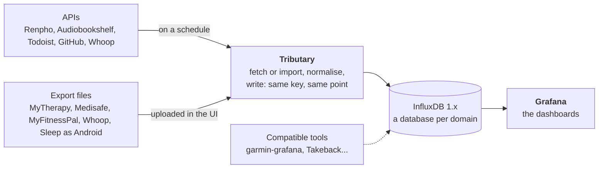
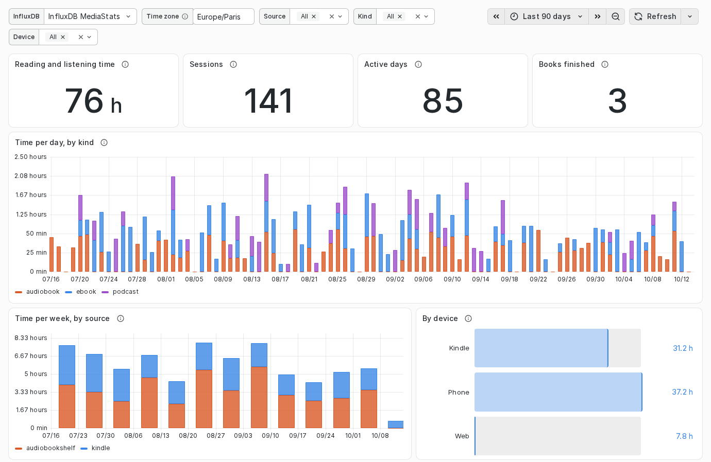

# Tributary

Tributary is the plumbing between the apps that hold your personal data and
your own Grafana. It reads each source, from its API on a schedule or from the
export file you upload, normalises what it finds to
[one shared schema](docs/schema.md), and writes it into **InfluxDB 1.x**,
where writing a point again replaces it instead of duplicating it. **The
graphs live in Grafana:** Tributary draws none of its own, and its web UI is
for runs, imports, schedules and settings. Think
[garmin-grafana](https://github.com/arpanghosh8453/garmin-grafana), for many
sources.



<picture>
  <source media="(prefers-color-scheme: dark)" srcset="docs/screenshots/overview-dark.png">
  
</picture>

<sub>The overview, with demo data: one row per source, in its category's colour.
Light or dark follows your system; the other pages are in [docs/ui.md](docs/ui.md).</sub>

- **Check before writing.** *Dry run* shows the exact line protocol and writes
  nothing; an export is checked first, then imported.
- **Safe to repeat.** A point is keyed by measurement, tags and time, so a
  rerun rewrites the same points. An API source only adds; an export replaces
  that source's own series (or only the days it covers), never another tool's.
- **One schema, many writers.** A database per domain (`MediaStats`,
  `BodyStats`...), a `source` tag per tracker, fixed field types: other tools
  write into the same databases, so one Grafana relates them all.
- **Private by default.** Numbers and a few tags; free text only where it is
  the point (a book's title) or when you ask (task names, dose notes); secrets
  stay in the environment, and the tokens of a source you connect in the
  browser (Whoop) are stored encrypted, never in plain text.

## Supported sources

| Source | Category | Gets its data | Writes: measurements → database | Default schedule |
|---|---|---|---|---|
| [**Renpho**](docs/connectors/renpho.md) | Body & health | API (one account per person) | `body_composition`, `body_levels`, `body_thresholds` → `BodyStats` | Daily at 02:52 |
| [**MyTherapy**](docs/connectors/mytherapy.md) | Medication | Export, uploaded in the UI | `medication` → `BodyStats` | none: you import a file |
| [**Medisafe**](docs/connectors/medisafe.md) | Medication | Export, uploaded in the UI | `medication` → `BodyStats` | none: you import a file |
| [**MyFitnessPal**](docs/connectors/myfitnesspal.md) | Nutrition & fitness | Export, uploaded in the UI | `body_composition`, `nutrition`, `exercise` → `BodyStats` | none: you import a file |
| [**Whoop**](docs/connectors/whoop.md), built on kryoseu's [Whoops](https://github.com/kryoseu/whoops) | Sleep | API (OAuth: connect on its page), and its export uploaded in the UI | `sleep_session`, `journal` → `SleepStats`; `daily_activity`, `exercise` → `BodyStats` | Daily at 10:35 |
| [**Sleep as Android**](docs/connectors/sleep_as_android.md) | Sleep | Export, uploaded in the UI | `sleep_session`, `sleep_stage`, `sleep_vitals` → `SleepStats` | none: you import a file |
| [**Audiobookshelf**](docs/connectors/audiobookshelf.md) | Reading & media | API | `reading_session`, `book_finished` → `MediaStats` | Daily at 03:10 |
| [**Todoist**](docs/connectors/todoist.md) | Productivity | API | `todoist_task_completed`, `todoist_completion`, `todoist_karma`, `todoist_stats` → `TodoistStats` | Daily at 00:30 |
| [**GitHub**](docs/connectors/github.md) | Productivity | API (a token per organisation or user) | `github_commit`, `github_workflow_run`, `github_actions_usage`, `github_actions_month` → `DevStats` | Daily at 04:15 |

Schedules are in `TRIBUTARY_TZ` and staggered so two runs never overlap;
change one on the source's page ([scheduling](docs/scheduling.md)). Each
source's page in [docs/connectors/](docs/connectors/README.md) says which
variables it reads and what it deliberately leaves out.

The **compatible tools** are maintained projects that write into the same
databases. Tributary does not run them: a connector is written only for a
source no maintained tool covers ([compatible tools](docs/compatible-tools.md)).
It only shows, read-only, when garmin-grafana's and fitbit-grafana's data last arrived.

| Compatible tool | Category | Writes |
|---|---|---|
| [**garmin-grafana**](https://github.com/arpanghosh8453/garmin-grafana) | Body & health, Sleep | InfluxDB `GarminStats` (activity, sleep, heart rate, body battery...), with its own dashboards |
| [**fitbit-grafana**](https://github.com/arpanghosh8453/fitbit-grafana) | Body & health, Sleep | InfluxDB `FitbitHealthStats` (heart rate, steps, sleep...), with its own dashboards |
| [**Takeback**](https://github.com/vchatela-org/takeback) | Reading & media, Productivity | InfluxDB `MediaStats`, `ShoppingStats`, `DigitalStats`, from GDPR archives (Kindle sessions, Audible, purchases...) |

## Graphs: in Grafana

Tributary only writes; dashboards read InfluxDB. [grafana/](grafana/) ships:

| Dashboard | Reads | Panels |
|---|---|---|
| [Healthspan](grafana/dashboards/healthspan.json) | `GarminStats` (garmin-grafana), `SleepStats`: `sleep_session`, `BodyStats`: `body_composition`, `exercise`, `daily_activity`, `medication` | WHOOP's nine healthspan indicators on its scales and colours, their age impacts and an estimated WHOOP Age, from the source you pick; HRV, weight, body fat, doses taken and every source's trends below |
| [Sleep](grafana/dashboards/sleep.json) | `GarminStats`: `SleepSummary`, `SleepStats`: `sleep_session` | time asleep, stages, score, resting heart rate, HRV, SpO₂, breathing, recovery, skin temperature, bedtime regularity, one colour per device |
| [Activity & fitness](grafana/dashboards/activity.json) | `GarminStats`: `DailyStats`, `ActivitySummary`, `VO2_Max`, `BodyStats`: `daily_activity`, `exercise` | steps, strain and calories burned per day, intensity minutes, VO₂ max, workouts per week by source, heart-rate zones |
| [Correlations](grafana/dashboards/correlations.json) | `SleepStats`, `GarminStats`, `BodyStats`, `TodoistStats`, `MediaStats` | a night (time asleep, HRV, sleep score) against the next day's tasks, evening reading against the night, training against HRV, per day and per week |
| [Reading & listening](grafana/dashboards/reading-listening.json) | `MediaStats`: `reading_session`, `book_finished` | time per day and per week by kind and source, sessions, active days, time by device, evening reading (by local hour), books finished |
| [Body composition](grafana/dashboards/body-composition.json) | `BodyStats`: `body_composition`, `body_levels`, `body_thresholds` | every metric's latest reading coloured by its level, a detail row per metric, the history by source |
| [Medication](grafana/dashboards/medication.json) | `BodyStats`: `medication` | doses taken, missed or skipped, the share taken per medication over time, a table per medication and per dose |
| [Nutrition & exercise](grafana/dashboards/nutrition-exercise.json) | `BodyStats`: `nutrition`, `exercise`, `body_composition` | calories per meal and macro split per logged day, workouts per day and week by activity, weight next to them |
| [Todoist](grafana/dashboards/todoist.json) | `TodoistStats`: `todoist_completion`, `todoist_task_completed`, `todoist_stats` | completions per day and project, due dates kept or missed, priority, streak and karma, the tasks above the night's sleep score and HRV |
| [GitHub](grafana/dashboards/github.json) | `DevStats`: `github_commit`, `github_workflow_run`, `github_actions_month`, `github_actions_usage` | commits by author (you, you with an agent, a bot, someone else), per week and per repository; the latest and longest workflow runs; hosted runner minutes against the included ones |
| [Habits & recovery](grafana/dashboards/habits-recovery.json) | `SleepStats`: `journal`, `sleep_session`, `GarminStats`: `SleepSummary` | a daily journal's answers from any source, and the night after a yes against the night after a no: recovery, HRV, time asleep, each from its picker |
| [Strength training](grafana/dashboards/strength-training.json) | `GarminStats`: `StrengthExerciseSet`, `StrengthHRZones` | volume, sets and reps, estimated one-rep max and records per exercise, time under tension, heart-rate zones |

<picture>
  <source media="(prefers-color-scheme: dark)" srcset="docs/screenshots/grafana-reading-dark.png">
  
</picture>

<sub>The Reading & listening dashboard in Grafana, with demo data (Audiobookshelf
plus Kindle sessions from Takeback). The others are in
[docs/dashboards.md](docs/dashboards.md).</sub>

- The quick start below provisions them: [grafana/provisioning/](grafana/provisioning/)
  declares an `InfluxDB <database>` datasource for `MediaStats`, `BodyStats`,
  `TodoistStats`, `SleepStats`, `DevStats` and garmin-grafana's `GarminStats`, and loads
  `grafana/dashboards/` into a *Tributary* folder.
- In a Grafana you already run, import the JSON: each dashboard uses any
  InfluxDB datasource whose name contains its database ([deployment](docs/deployment.md#docker-compose)).
- They read the schema, not a connector: points another tool writes the same
  way (Kindle sessions from Takeback, another scale) show up in the same
  panels.
- A value several devices measure (weight, heart rate, sleep, steps) is one
  series per source, each source in the same colour on every dashboard; a tile
  or a correlation reads the one source you pick, with one picker per value
  (*Sleep from*, *Sleep score from*, *HRV from*...): never two devices
  stitched into one series ([design](docs/dashboards-design.md)).
- They ship with nothing saved in them: no user, source or medication is
  selected until your data fills the lists. To open the pickers on your own
  sources, save them as defaults in your copy: a provisioned dashboard is
  overwritten by its file at the next provisioning.

## Quick start

With Docker and Docker Compose:

```sh
git clone https://github.com/vchatela-org/tributary.git
cd tributary
cp .env.example .env    # then set the sources you use, e.g. TRIBUTARY_ABS_URL and TRIBUTARY_ABS_TOKEN
docker compose up -d
```

This builds Tributary and starts it with InfluxDB 1.x and Grafana:

- Tributary: <http://127.0.0.1:8000>. Each configured source runs on its
  schedule; *Run now* and *Dry run* show what it does before that. An export
  source is imported from its page: the file is checked first, then imported.
  Its sidebar's *Dashboards* opens Grafana's, filtered to the ones below
  (`TRIBUTARY_GRAFANA_URL`; the compose file sets it).
- Grafana: <http://127.0.0.1:3000> (first login `admin` / `admin`), with the
  datasource and the dashboards of [grafana/](grafana/) in a *Tributary*
  folder.

Every setting is an environment variable: [.env.example](.env.example), and
the full list in [docs/deployment.md](docs/deployment.md#configuration), which
also covers an existing InfluxDB or Grafana, and Kubernetes.

**No login.** Tributary has no accounts: anyone who reaches its port can start
runs. Keep it local (the compose file binds `127.0.0.1`) or put an
authenticating reverse proxy in front (Authentik, Authelia, oauth2-proxy...):
[docs/deployment.md](docs/deployment.md#no-login-keep-it-private).

## Documentation

- [The web UI](docs/ui.md): the overview, a source's page, importing an
  export, the run history, settings, and the HTTP API.
- [Scheduling](docs/scheduling.md): cron per source, where a value comes from,
  what a missed run does.
- [Deployment](docs/deployment.md): every setting, Docker Compose, Kubernetes,
  upgrades.
- [Connectors](docs/connectors/README.md): one page per source, and how to
  write one.
- [The shared schema](docs/schema.md): every measurement, tag and field type,
  for Tributary and the tools writing next to it.
- [Compatible tools](docs/compatible-tools.md) and
  [porting a job that already feeds InfluxDB](docs/porting.md).

## Contributing

A new source is welcome when no maintained tool covers it yet
([before writing one](docs/connectors/README.md#before-writing-one)). Run the
tests and the privacy scan before pushing, and title the PR as a conventional
commit, since it decides the release: [development and releases](docs/development.md).

## Acknowledgements

The Whoop connector is built on [Whoops](https://github.com/kryoseu/whoops), by
**kryoseu**: its WHOOP client, its field mapping and `score_state` handling,
and its export import were adapted rather than rewritten. Thank you, kryoseu:
Whoops showed how to get one's own WHOOP data out, and made this connector
mostly a port.

## License

[MIT](LICENSE). The files adapted from Whoops keep its licence, the
[Apache License 2.0](LICENSES/Apache-2.0.txt): see [NOTICE](NOTICE).
