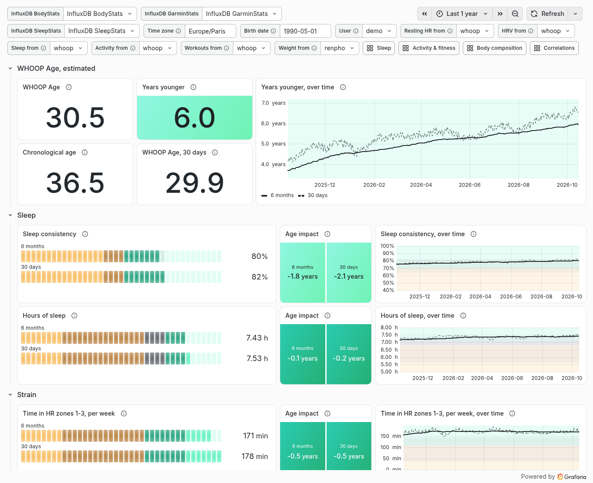
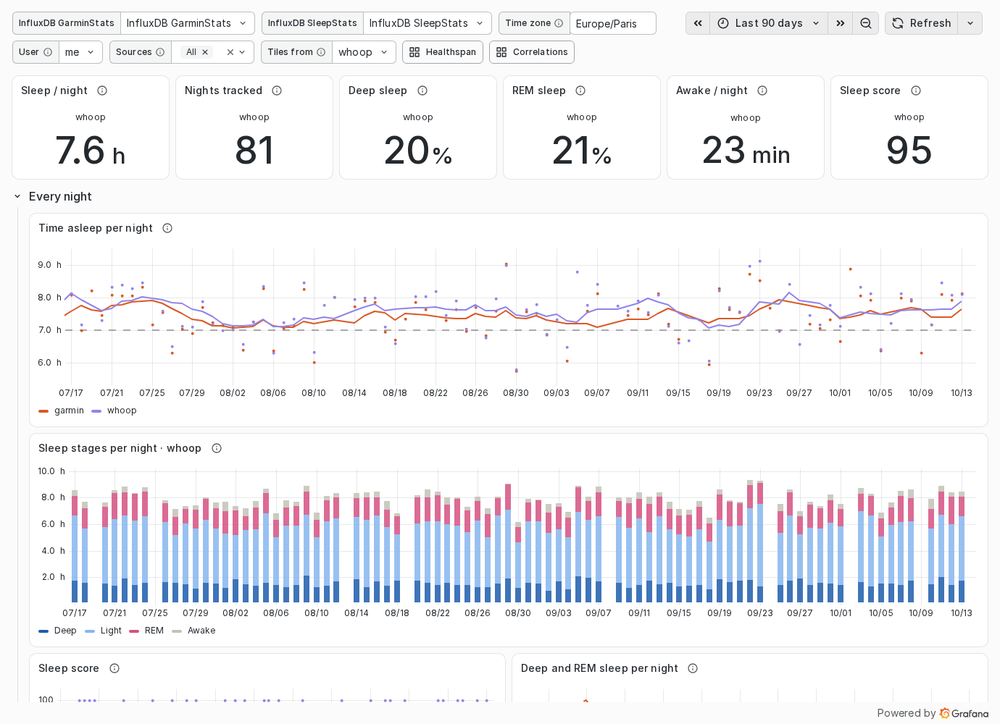
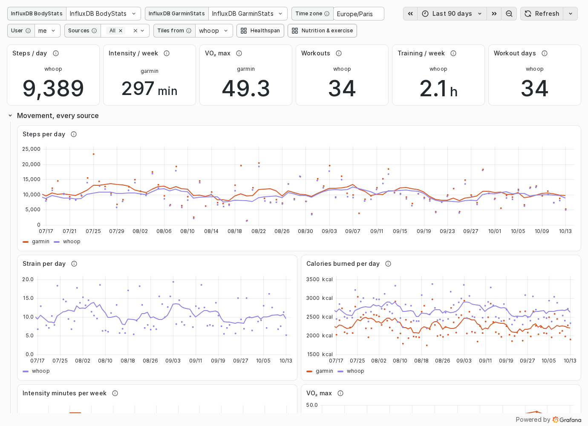
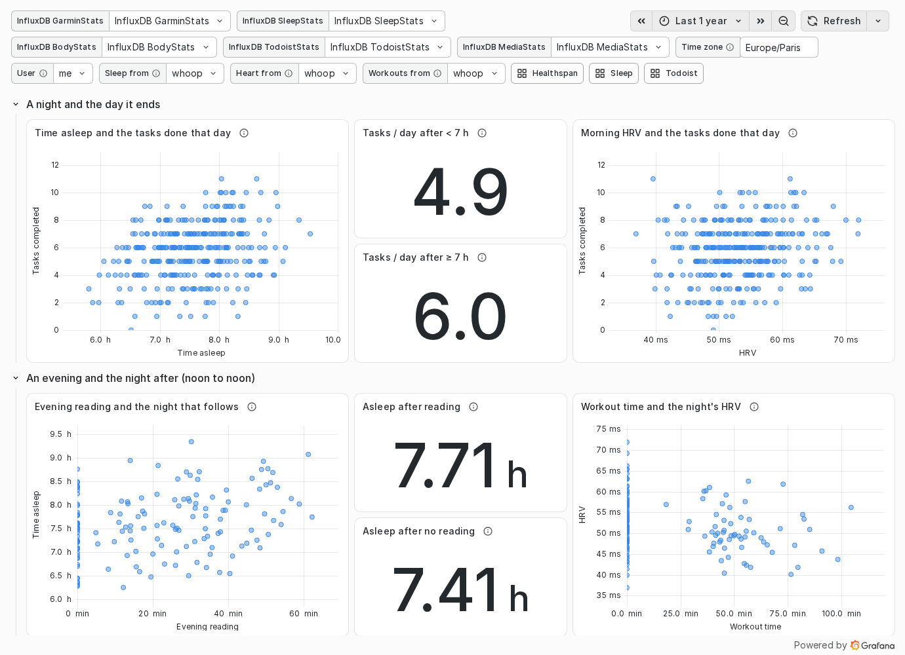
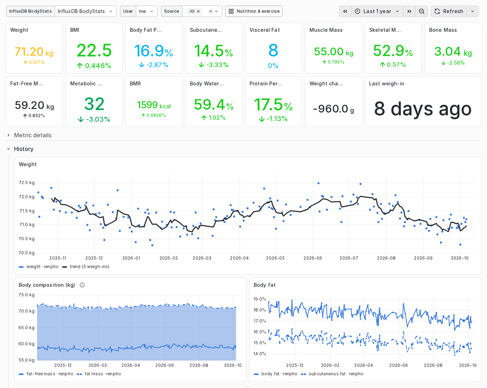
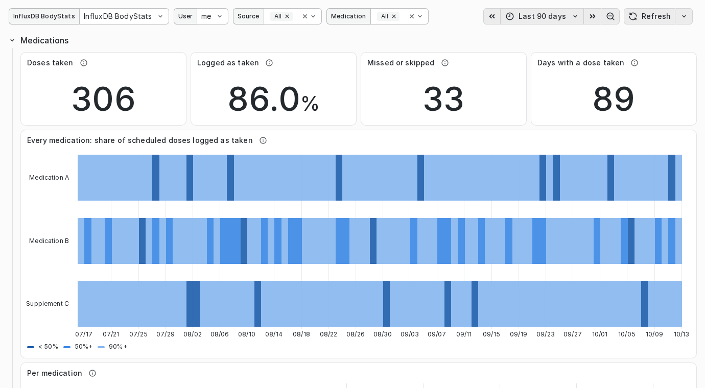
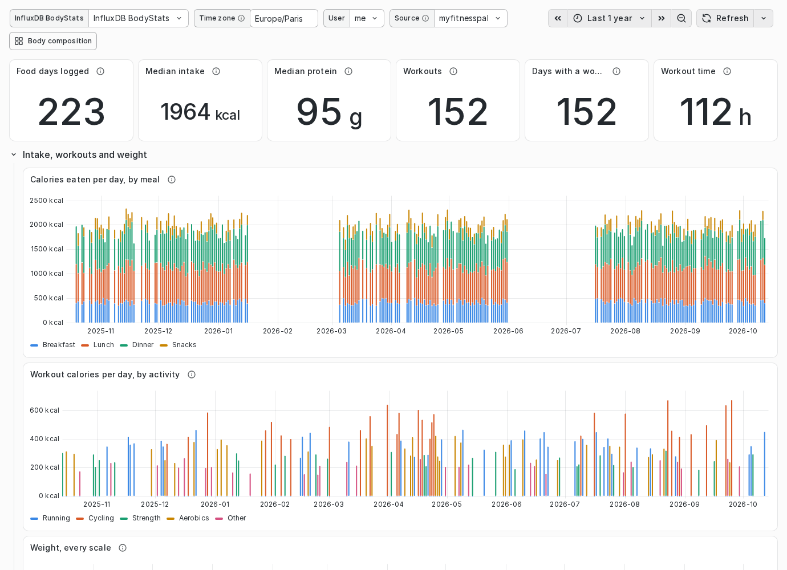
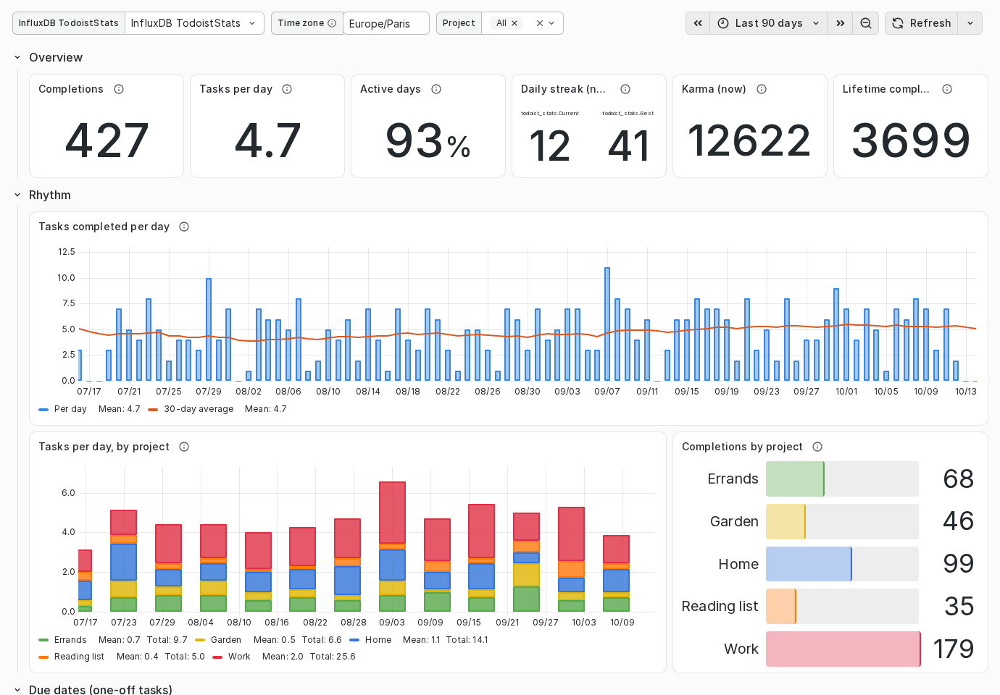

# The Grafana dashboards

Tributary draws no graphs: [grafana/dashboards/](../grafana/dashboards/) ships
dashboards that read InfluxDB, for the series Tributary writes and the ones
other tools write the same way ([the schema](schema.md)). The quick start
provisions them, with a datasource per database
([grafana/provisioning/](../grafana/provisioning/)). In a Grafana you already
run, import the JSON: each one finds its datasource by name (any InfluxDB
datasource whose name contains its database, `BodyStats` for example).

They ship with nothing saved in them. No user, source, project or medication
is preselected, and no panel is about one person's data: the lists fill from
your own series. The time zone the days are cut in is a variable (`tz`), set
to the same default as `TRIBUTARY_TZ`. The screenshots below show demo data.

A value that several sources measure (weight, heart rate, sleep, steps,
workouts) is drawn as one series per source, each source in the same colour on
every dashboard. A single number, such as a tile or a correlation, reads the
one source you pick in a variable, because two devices that disagree are never
averaged. There is one such picker per value (*Sleep from*, *Sleep score
from*, *HRV from*, *Resting HR from*, *Activity from*, *Workouts from*,
*Weight from*), with the same name on every dashboard. To open them on your
own source, save that source as the variable's default in your copy of the
dashboard. The rules, the series other tools write and the dashboards proposed
next are in [dashboards-design.md](dashboards-design.md).

## Healthspan

WHOOP's Healthspan screen, for any source: nine indicators of sleep, strain
and fitness, each on WHOOP's scale and in its colours, with the years it adds
to or takes off an estimated WHOOP Age.

- **WHOOP Age, estimated:** the chronological age plus the nine age impacts
  of the last 6 months; the years younger, the same sum on the 30-day
  averages, and the years younger day by day over the time range.
- **Sleep:** sleep consistency, hours of sleep.
- **Strain:** time in heart-rate zones 1-3 and 4-5 per week, strength
  activity time per week, steps per day.
- **Fitness:** VO₂ max, resting heart rate, lean body mass (100 % less body
  fat).

Each indicator has two bars, the averages of the 6 months and of the 30 days
that end with the time range (WHOOP's ▼ and ▲ markers), its age impact for
each, and its trend over the same colour bands. Orange adds years, grey is
about 0, green takes them off. Under the bars, as in the app, the two ends
of the scale (5 h and 8 h for hours of sleep), and an arrow at the
guideline, the value worth 0 years. Step the time range back to see an
earlier week, as with the app's arrows. On a phone, Grafana stacks the
panels in grid order: the scale's line comes after the indicator's trend.

**The model.** WHOOP gives each indicator a guideline worth 0 years. Here each
age impact is a straight line through it, `years = k × (value − guideline)`,
with `k` fitted on screenshots of the app. WHOOP's own slopes depend on age
and sex: read the years as an estimate, the bars and the bands as WHOOP's. The
constants, scales and bands are in
[`scripts/build-healthspan-dashboard.py`](../scripts/build-healthspan-dashboard.py),
which writes the JSON. VO₂ max is the watch's (garmin-grafana): WHOOP's own
estimate is in no export, so a strap alone leaves it out of the sum. An
indicator with no data counts as 0 years.

WHOOP Age and the chronological age need the *Birth date* variable
(YYYY-MM-DD), empty as shipped: those two tiles show an error until it is
set, and nothing else uses it. Save it in your copy of the dashboard, like a
source.

Below, collapsed, **Other markers, every source**: HRV, the spread of time
asleep, intensity minutes per week (the WHO guideline is 150), workout hours
per week, weight, its change and body fat, the share of medication doses
taken; then each marker's trend from every source in its own colour, each
night or day as a point and its 7-day average as a line, the guidelines as
dashed lines.

Each value reads the source picked for it: *Sleep from* (consistency, hours
of sleep), *Workouts from* (zones, strength), *Activity from* (steps),
*Resting HR from*, *Weight from* (lean body mass), and *HRV from* for the
markers below. Strength is the `strength` category (WHOOP's weightlifting,
powerlifting, functional fitness; MyFitnessPal's), or Garmin's
`strength_training`. Reads:
- `GarminStats` (garmin-grafana): `SleepSummary`, `DailyStats`, `VO2_Max`,
  `ActivitySummary`, `BodyComposition`;
- `SleepStats`: `sleep_session`;
- `BodyStats`: `body_composition`, `exercise`, `daily_activity`,
  `medication`;
- `FitbitHealthStats` (fitbit-fetch): `Sleep Summary`, `Total Steps`,
  `RestingHR`, and below `HRV`.

## Sleep

Every night from every sleep tracker: `GarminStats..SleepSummary`,
`SleepStats..sleep_session` and `FitbitHealthStats..Sleep Summary`, naps left
out. Nights are cut noon to noon, so a source that stamps a night at its
start (Fitbit) and one that stamps it at its end (Garmin, WHOOP) land on the
same point.
- **Tiles**, from the source picked in *Sleep from*: time asleep, nights
  tracked, deep and REM share, time awake; the sleep score from *Sleep score
  from* (Fitbit has no score: it records an efficiency, not drawn as one).
- **Every night:** time asleep per night, one colour per source, against a
  7-hour line; the picked source's stages per night (deep, light, REM,
  awake); sleep score; deep and REM averages; time awake per source; the
  share of deep, light and REM per source.
- **Overnight:** resting heart rate (Sleep as Android's lowest heart rate of
  the night, as the app records no resting value), HRV, blood oxygen,
  breathing rate, recovery score and skin temperature.
- **Regularity:** usual bedtime and wake-up and their spread, from the
  sources that record a bedtime; the weekly spread of time asleep, and its
  nights, mean, p10 and p90 per source.
- **Coverage and naps:** the share of the last 30 days with a tracked night,
  per source (which device covers which years), and naps per week.
- **One night in detail** (folded): the hypnogram and the heart rate through
  the night, from the sources that store them (`SleepStats`: `sleep_stage`,
  `sleep_vitals`; `GarminStats..SleepIntraday`; `FitbitHealthStats..Sleep
  Levels`). Zoom the range to a night.

Fitbit has no clock times: its bedtime and wake-up tiles stay empty when it is
picked.

Variables: user, sources, *Sleep from*, *Sleep score from*.

## Activity & fitness

How much you move and train, every source side by side. Reads `GarminStats`
(`DailyStats`, `ActivitySummary`, `VO2_Max`), `BodyStats` (`daily_activity`,
`exercise`) and `FitbitHealthStats` (`Total Steps`, `calories`,
`Activity Records`).
- **Tiles**, devices listed first: steps per day from *Activity from*;
  intensity minutes per week and VO₂ max (`garmin`); workouts, training hours
  per week and days with a workout from *Workouts from*.
- **Per day:** steps, strain, calories burned, each source as points and a
  7-day average.
- **Per week:** intensity minutes against the 150-minute guideline; VO₂ max,
  running and cycling.
- **Workouts per week, one line per source:** time, count and calories; a
  workout that two apps received is in both lines.
- **Heart-rate zones:** time per zone, from the source picked in *Workouts
  from*.
- **Workouts by sport,** from the source picked in *Workouts from*, by the
  sport it names: workouts per week, a table per sport (duration, strain,
  calories, heart rate), the share of time in each heart-rate zone, the
  strain of each workout.

Fitbit feeds steps, calories and workouts (time, calories, average heart
rate, sport names). Its heart-rate zones are daily totals rather than per
workout and it has no strain, so the workout-zone and strain panels leave it
out.

Variables: user, sources, *Activity from*, *Workouts from*.

## Correlations

One domain against another. Each point is one pairing window, and each panel
reads the sources picked in *Sleep from*, *Sleep score from*, *HRV from* and
*Workouts from*.
- **A night and the day it ends:** time asleep, the morning's HRV, or the
  sleep score, against the Todoist tasks completed that day. Tiles give the
  average tasks after a night under 7 hours and after one of 7 hours or more,
  and after a score under 70 and of 70 or more (each device scores on its own
  scale).
- **An evening and the night after (noon to noon):** evening reading (18:00
  to 03:00, every reading source) against the time asleep, with the same
  split; workout minutes against the next night's HRV.
- **Weeks:** training hours against the week's HRV; sleep against tasks.

Reads `SleepStats`, `GarminStats`, `BodyStats`, `TodoistStats` and
`MediaStats`. Its range defaults to a year, so the clouds have enough points.

## Reading & listening

`MediaStats`: `reading_session`, `book_finished`. Time per day and per week by
kind and source, sessions, active days, time by device, evening reading by
local hour with the sleep score of the night after (from *Sleep score from*,
on the same noon-to-noon windows), books finished. Its screenshot is in the
[README](../README.md#graphs-in-grafana).

## Body composition

`BodyStats`: `body_composition`, `body_levels`, `body_thresholds`, and
garmin-grafana's `GarminStats..BodyComposition`. Per user:
- the latest reading of every metric, coloured by its level (the scale
  app's own boundaries, from `body_thresholds`);
- a folded detail row per metric: gauge, level, change over the range,
  history.

The tiles and detail rows read one source, the one picked in *Readings from*
(a scale that rates its readings is listed first). The history of every
metric draws each source in its own colour, with a trend per source.
Variables: user, sources, *Readings from*.

## Medication

`BodyStats`: `medication`, from every source that writes it (MyTherapy,
Medisafe). Doses taken, the share logged as taken, missed or skipped, days
with a dose taken; a strip per medication of the share taken in each bucket;
a table per medication (first and last dose, scheduled, taken) and every dose
with its status, delay and note.

**A medication and the nights:** set the time range to start on the day a
medication began, stopped or changed. Tiles compare the nights in the range
with the same length of time just before it: nights, time asleep, time
awake, awakenings, deep and REM sleep, sleep score and resting heart rate,
each from its picker. 30-night averages below draw every source. No date is
saved in the dashboard: the range is the date.

Variables: time zone, user, source, medication, *Sleep from*, *Sleep score
from*, *Resting HR from*.

## Nutrition & exercise

`BodyStats`: `nutrition`, `exercise`, and `body_composition` for the weight.
Food days logged, median intake and protein (on days with at least 3 meals
logged), calories per meal for each logged day, the macro split, a table per
day; workouts per day and per week by activity, workout time, the device
calorie adjustment, every workout; every scale's weigh-ins on the same time
axis, garmin-grafana's included.

**Eaten and burned:** on fully logged food days (lunch and dinner, or at least
3 meals), the calories eaten against every tracker's burn (a watch's resting
and active calories, on days it was worn; a strap's day). The daily balance
subtracts the burn of the tracker picked in *Activity from*; a day either side
lacks stays empty.

Variables: user, source (one at a time: the panels sum per day), *Activity
from*.

## Todoist

`TodoistStats`: `todoist_completion`, `todoist_task_completed`,
`todoist_stats`. Completions, tasks per day, active days, the app's streak
and karma; completions per day with a 30-day average, per project, and by
priority; for one-off tasks, done by the due date or late, lead time and
postponements; every completion (task names only when
`TRIBUTARY_TODOIST_TASK_TEXT` is on). **Productivity and recovery:** the
tasks per day above the sleep score and the overnight HRV of every source,
on one time axis. Variables: time zone, project, user (whose nights).

## Habits & recovery

`SleepStats..journal`: a daily journal of yes or no questions, from any
source that writes one (the Whoop journal, from the Whoop connector's export
import, or another tool's), against the night that follows each day, read
from the sources picked in *Recovery from*, *HRV from* and *Sleep from*. A day
runs noon to noon, so an answer, stamped at noon on its day, meets the night
that ends the next morning, whichever journal it comes from.
- **Every question:** a calendar of the answers, the yes rate per question,
  and, per question, the next morning's recovery and the night's HRV after
  the days answered yes against the days answered no.
- **One question** (picked in *Question*): the same for that question, with
  the time asleep; the share of yes days over the last 30.

A day with no answer is a day the question was not tracked or not logged,
never a no. It is correlation, not cause: a factor and an answer can share a
third reason, and few days make the difference noise. Variables: time zone,
user, source, question, recovery from, HRV from, sleep from.

## Strength training

garmin-grafana's `GarminStats`: `StrengthExerciseSet`, `StrengthHRZones` (a
Garmin watch's weight training, one point per set). Total volume, sets, reps
and workouts; the estimated one-rep max per exercise (Epley) and personal
records; volume per workout; volume and sets by category; the latest sets and
a summary per session; time per heart-rate zone and time under tension per
exercise; workouts per week, a calendar, and the sets Garmin could not
classify. Variables: time zone, exercise category, exercise.

## GitHub: commits and hosted minutes

`DevStats`, from the [GitHub connector](connectors/github.md): `github_commit`,
`github_actions_month`, `github_actions_usage`.
- **Hosted minutes** (GitHub's billing report): this month's minutes counted
  against the 2,000 a free plan includes, per account (yellow from 80%, red at
  2,000); each account's months against the same line; the minutes per
  repository over the range (public repositories' are free). Counted minutes
  keep only the private repositories' standard runners, with GitHub's
  multipliers (Windows ×2, macOS ×10).
- **Commits** on the default branches, merges and forks left out: totals by
  author (you alone, you with an agent, a bot, someone else), the share of your
  commits made with an agent, commits per week by author, and per repository
  for each account.

The connector writes one point per account and month, on its first day: the
monthly panels draw those, as InfluxQL has no calendar month. Variables:
time zone, account.
