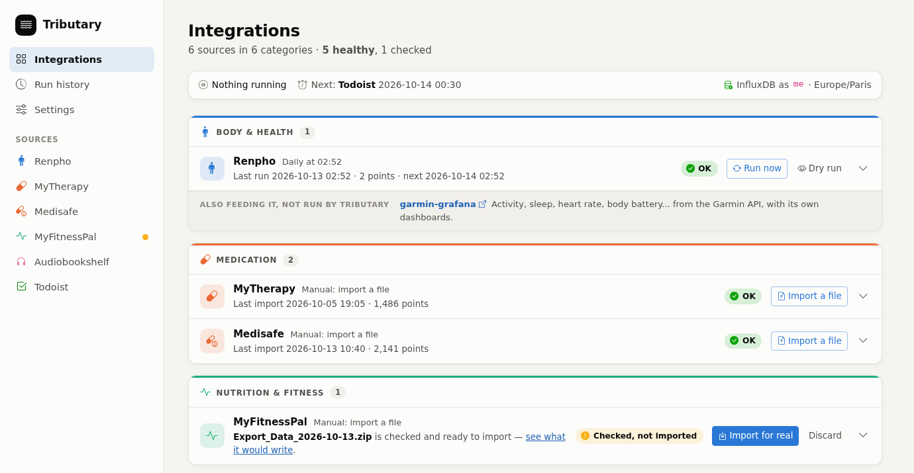
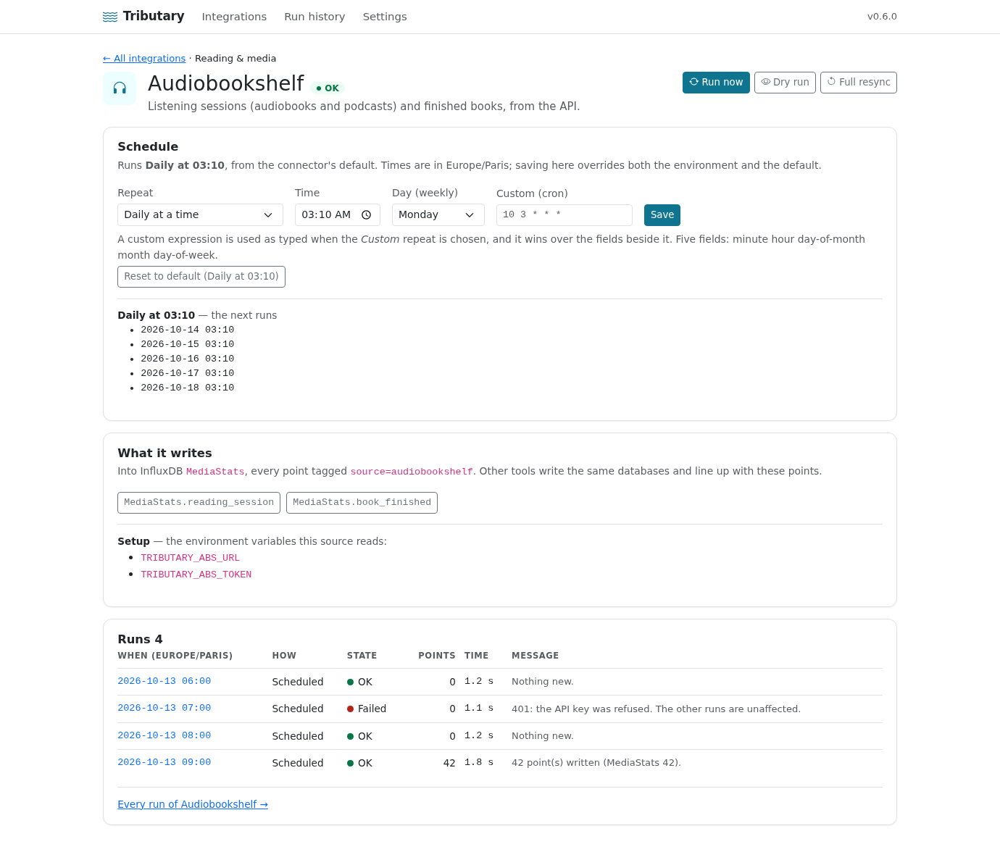
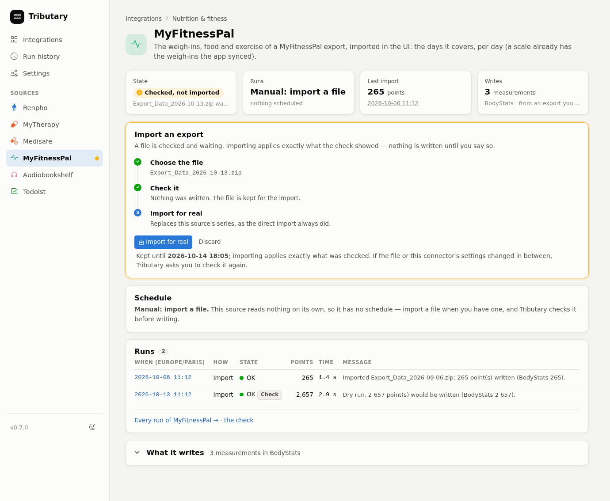
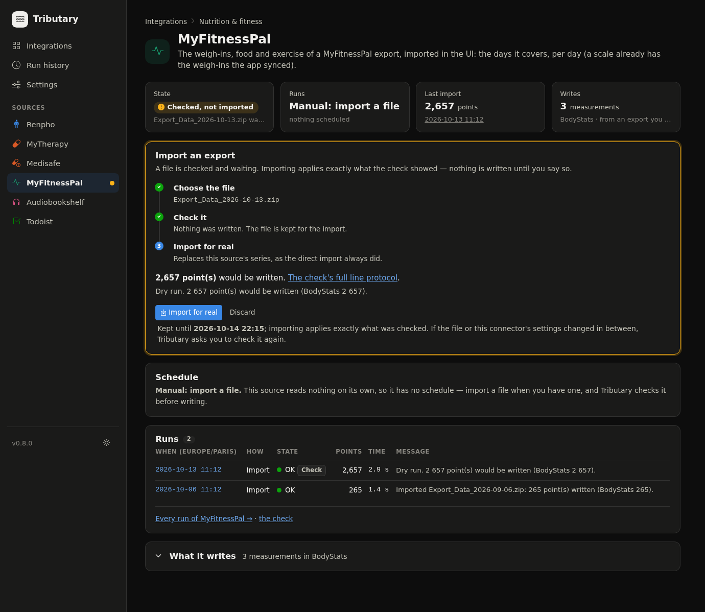
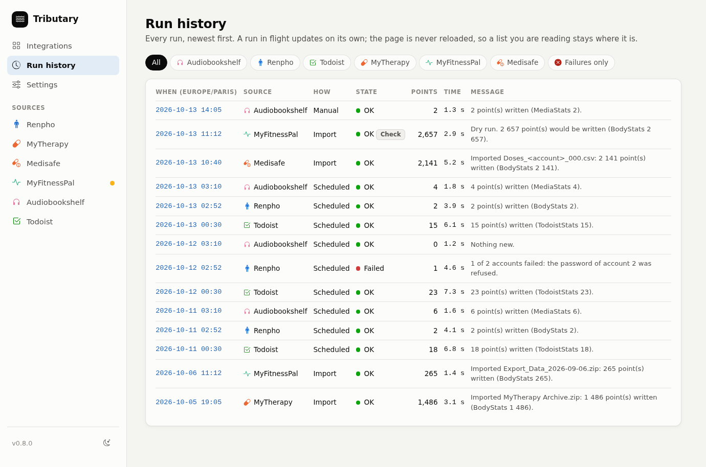
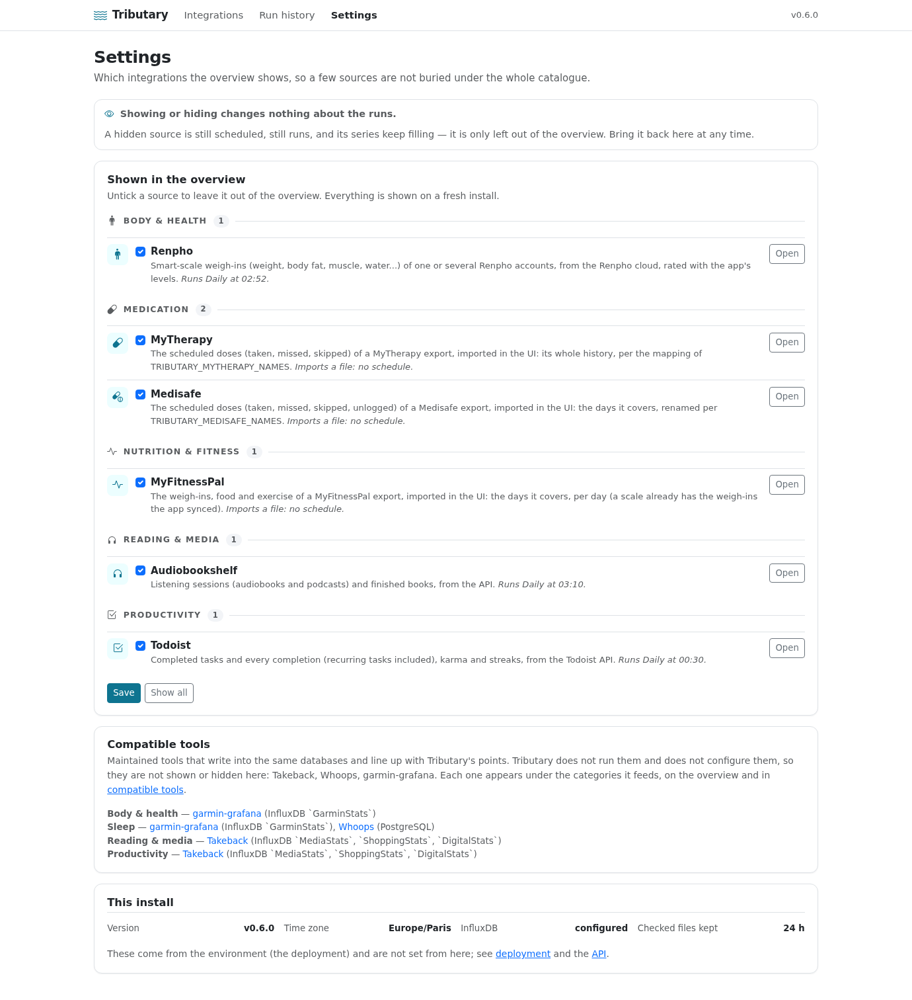

# The web UI

Tributary's UI runs and checks the sync; it does not chart the data (that is
Grafana's job, see the [README](../README.md#graphs-in-grafana)). A sidebar on
every page leads to the overview, monthly imports, the run history, settings and each source;
with `TRIBUTARY_GRAFANA_URL` set, *Dashboards* opens Grafana's dashboard
browser, filtered to the dashboards shipped in
[grafana/dashboards](../grafana/dashboards/) (the link leaves Tributary, so it
is marked as an external one). Light and dark follow your system until you
pick one at the foot of the sidebar. The screenshots on this page show demo
data.

## The overview

Every source, grouped by category, one row each in its category's colour: its
status, its schedule, its last and next run, and *Run now* and *Dry run* (the
exact line protocol, nothing written), or *Import a file* for a source that
takes an export. The chevron unfolds the rest: what it reads and writes, the
file picker of a source you import into, and a link to its page. The
compatible tools are listed under the categories they feed, marked as not run
by Tributary. garmin-grafana's card says when its data last arrived (*Garmin
data up to ... · last watch upload ...*), marked *Over 24 h old* with the
warning sign when it is stale; that is when, not why
([compatible tools](compatible-tools.md#when-garmin-grafanas-data-last-arrived)).
The page never reloads itself: a run in progress updates in
place, so a file you are choosing stays chosen.

Every source is shown unless you hide it in [Settings](#settings); hiding
never stops a run.

## A source's page

Its state at a glance (status, schedule, last run, what it writes), then its
schedule with the next five runs, its runs, and, folded, what it writes and the
environment variables it reads. *Run now*, *Dry run* and *Full resync* (ignores
the cursor and rewrites everything the source has) sit at the top. *Change the
schedule* unfolds the editor: a preset (*Every hour*, *Daily at a time*,
*Weekly on a day and time*) or a cron expression you type. Times are absolute,
so a restart does not shift them. Where a schedule comes from, and what a
missed run does: [scheduling](scheduling.md).

A source you connect in the browser (Whoop) has a *Connection* block first:
*Connect* sends you to the source's own page to grant access and brings you
back; then it says *Connected* (never showing a token, which is stored
encrypted), with *Reconnect* and *Disconnect* (revokes the access, then forgets
it). What is missing to connect (the app's variables, the secret key) is said
there instead of the button. For a plain `http://` install, *Back from Whoop,
on a page that doesn't load?* takes the address the browser landed on
([Whoop](connectors/whoop.md#a-plain-http-install)).

A source that reads what others write (the [WHOOP models](connectors/whoop_model.md))
also has *Refresh inputs and run*. It opens its **refresh page**,
`/connectors/<key>/refresh`, which the Sleep planner dashboard links to as
*Refresh now*. The page lists the steps: each compatible tool with a
[refresh hook](compatible-tools.md#refresh-hook-asking-a-tool-to-fetch-now)
asked to fetch now, each Tributary source it reads run, then the source itself.
Its one button starts them, and the steps update in place. Below them, each
tool's freshness line says how old its data is, and *Back to the Sleep planner*
leads to the dashboard when `TRIBUTARY_GRAFANA_URL` is set. Opening the page
starts nothing; pressing the button again while a refresh runs joins it. Its
runs are recorded with the trigger *Refresh*. It fits a phone screen.

## Importing an export

A source that only has a "download your data" file is imported from its page.
Tributary **checks the file first**: nothing is written, the page shows the
line protocol, and the file is kept so *Import for real* does not ask for it
again. It lives on the data volume for a day and is deleted once imported. A
file the check no longer stands for (it was replaced, or a setting changed) is
refused and asked to be checked again. The check also compares the file with
what InfluxDB already holds and says how many of its points are **new,
changed or unchanged**: a backup reimported whole mostly restates the history,
so this says how much it actually adds or corrects.

## Monthly imports

**Imports** gathers the file exports you choose into one monthly checklist. On a
fresh install it tracks App Usage, MyTherapy, MyFitnessPal and Whoop; the
**Monthly imports** panel in [Settings](#settings) can remove one or add another
file source such as Stryd. Overview visibility is unrelated: a hidden source can
still have a monthly import.

Each source has its file picker and the same **Check file** → **Import for real**
workflow as its own page, returning to the checklist after each action. Checked
files, failures and running imports are shown next to the monthly state. Status
and actions update in place without replacing a file picker.

A successful, non-check upload completes the source for the current calendar
month in `TRIBUTARY_TZ`, even when it writes zero points. If a selected source
has nothing new to export, **No data to import** clears only that source for the
month. This acknowledgment is separate from run history: it creates no import,
changes no measurement, and can be reversed with **Undo no data**. Old
acknowledgments remain stored but do not complete later months; a real import
always takes precedence.

Checks, failed imports, watched-folder runs and API syncs do not complete an
item; in particular, Whoop's daily API run never completes its manual export. A
later failure remains visible without erasing an earlier success or no-data
acknowledgment in the month. **Done** confirms when an export was successfully
imported, not the range of dates inside that export.

## Run history

Every run is kept, with its trigger, result, point count and message; a check's
line protocol is readable and copyable. The page filters by source and by
failure, and updates a run in progress without reloading itself.

## Settings

**Settings** chooses which sources the overview shows, so a few of them are not
buried under the whole catalogue. It is display only: a hidden source is still
scheduled, still runs, and its series keep filling. Everything is shown on a
fresh install, and everything can be brought back from the same page. A separate
**Monthly imports** panel chooses the file sources on the checklist without
changing overview visibility or schedules. Below, the compatible tools by
category, with garmin-grafana's freshness line.

## The API

`/docs` has the OpenAPI description. In short: `GET /api/connectors`,
`GET /api/runs`, `GET /api/runs/{id}` (a dry run's line protocol),
`POST /api/connectors/{key}/run?dry_run=&full=`,
`GET|POST /api/connectors/{key}/refresh` (a derived source: fetch what it reads, then run it),
`POST /api/connectors/{key}/upload?dry_run=`,
`GET|PUT /api/connectors/{key}/schedule`,
`POST /api/connectors/{key}/import` (import what a check kept),
`DELETE /api/connectors/{key}/staged`, `GET|POST /api/preferences`,
`GET /api/health`.
