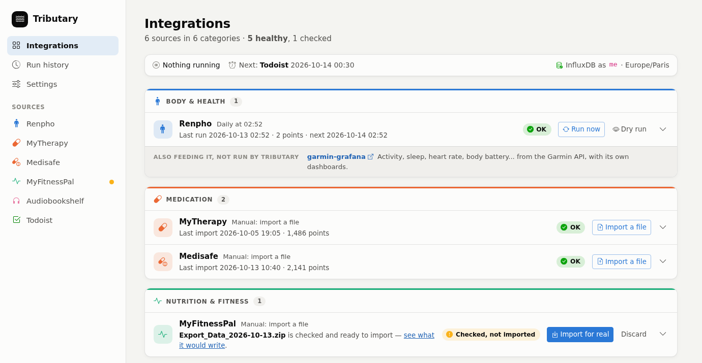
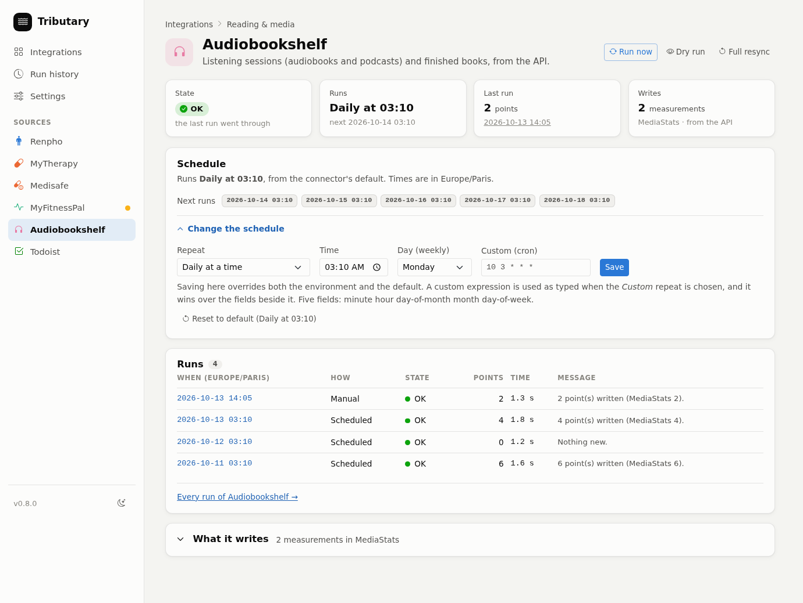
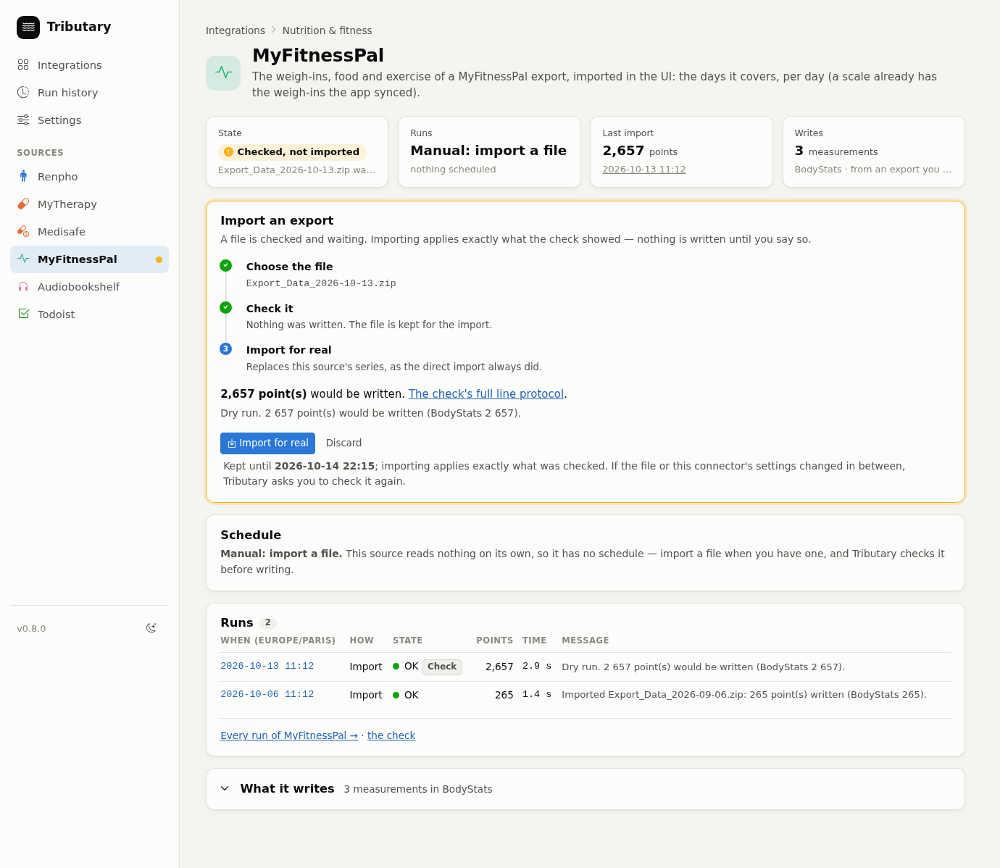
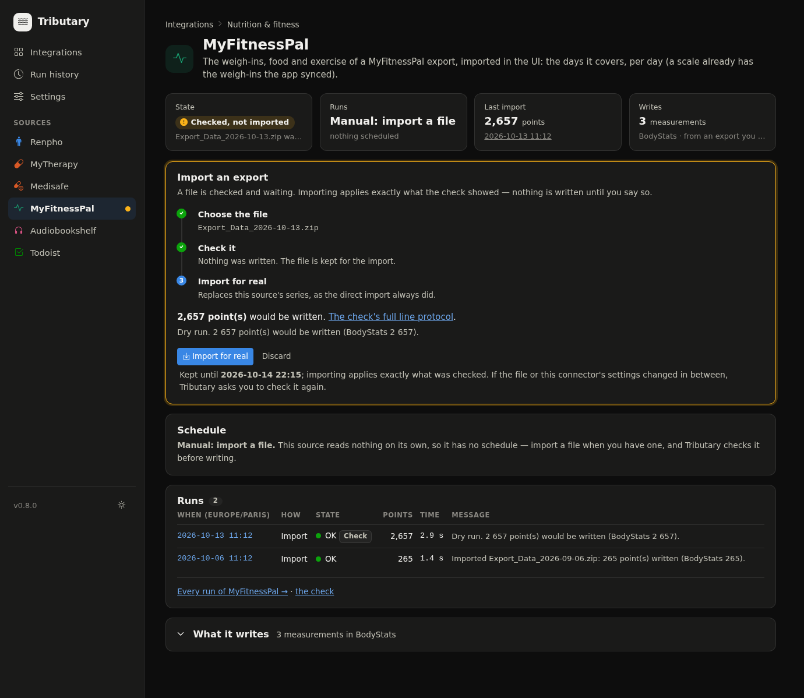
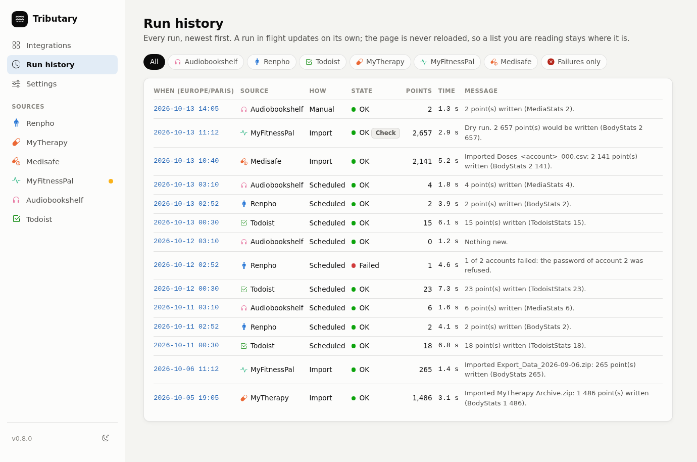
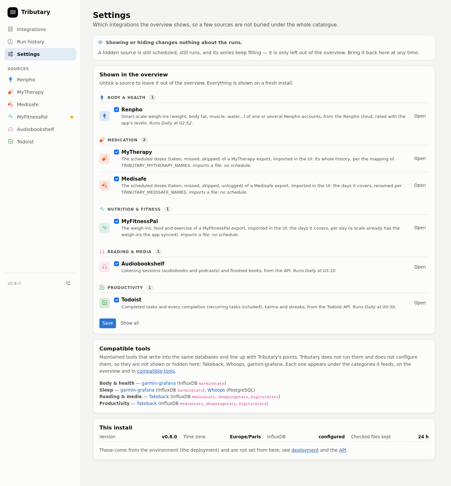

# The web UI

Tributary's UI runs and checks the sync; it does not chart the data (that is
Grafana's job, see the [README](../README.md#graphs-in-grafana)). A sidebar on
every page leads to the overview, the run history, settings and each source.
Light and dark follow your system until you pick one at the foot of the
sidebar. The screenshots on this page show demo data.

## The overview

Every source, grouped by category, one row each in its category's colour: its
status, its schedule, its last and next run, and *Run now* and *Dry run* (the
exact line protocol, nothing written), or *Import a file* for a source that
takes an export. The chevron unfolds the rest: what it reads and writes, the
file picker of a source you import into, and a link to its page. The
compatible tools are listed under the categories they feed, marked as not run
by Tributary. The page never reloads itself: a run in progress updates in
place, so a file you are choosing stays chosen.

Every source is shown unless you hide it in [Settings](#settings); hiding
never stops a run.

## A source's page

Its state at a glance (status, schedule, last run, what it writes), then its
schedule with the next five runs, its runs, and, folded, what it writes and the
environment variables it reads. *Run now*, *Dry run* and *Full resync* (ignores
the cursor and rewrites everything the source has) sit at the top. *Change the
schedule* unfolds the editor: a preset (*Every hour*, *Daily at a time*,
*Weekly on a day and time*) or a cron expression you type. Times are absolute,
so a restart does not shift them. Where a schedule comes from, and what a
missed run does: [scheduling](scheduling.md).

## Importing an export

A source that only has a "download your data" file is imported from its page.
Tributary **checks the file first**: nothing is written, the page shows the
line protocol, and the file is kept so *Import for real* does not ask for it
again. It lives on the data volume for a day and is deleted once imported. A
file the check no longer stands for (it was replaced, or a setting changed) is
refused and asked to be checked again.

## Run history

Every run is kept, with its trigger, result, point count and message; a check's
line protocol is readable and copyable. The page filters by source and by
failure, and updates a run in progress without reloading itself.

## Settings

**Settings** chooses which sources the overview shows, so a few of them are not
buried under the whole catalogue. It is display only: a hidden source is still
scheduled, still runs, and its series keep filling. Everything is shown on a
fresh install, and everything can be brought back from the same page.

## The API

`/docs` has the OpenAPI description. In short: `GET /api/connectors`,
`GET /api/runs`, `GET /api/runs/{id}` (a dry run's line protocol),
`POST /api/connectors/{key}/run?dry_run=&full=`,
`POST /api/connectors/{key}/upload?dry_run=`,
`GET|PUT /api/connectors/{key}/schedule`,
`POST /api/connectors/{key}/import` (import what a check kept),
`DELETE /api/connectors/{key}/staged`, `GET|POST /api/preferences`,
`GET /api/health`.
